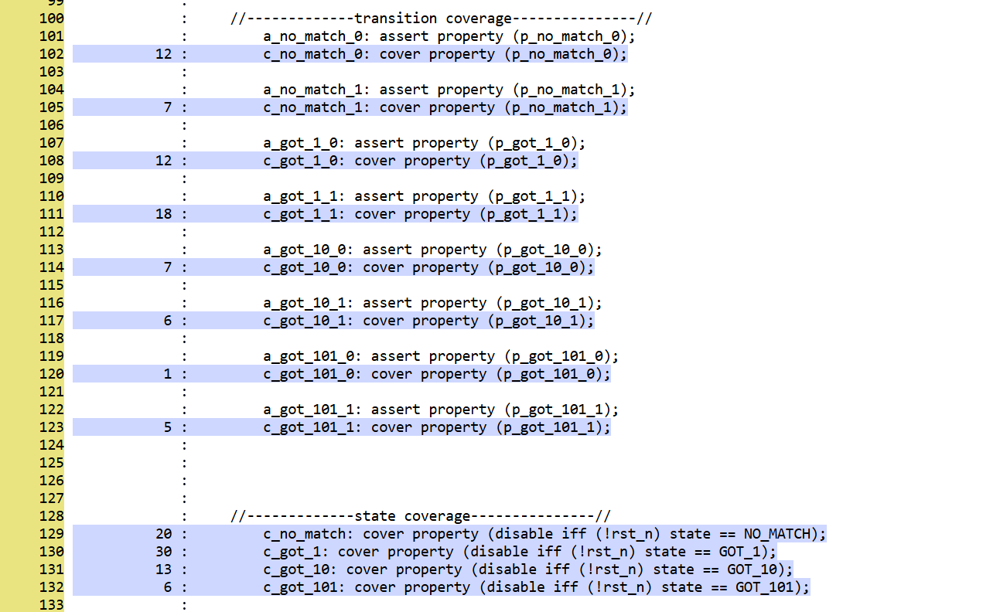
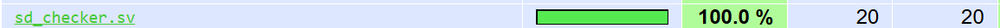

# Sequence Detector UVM Testbench

Hey! This is UVM verification environment for a Mealy FSM that detects the
overlapping bit pattern `1011`. Simulation, SVA, and coverage run with
Verilator; LCOV generates a browser-based coverage report!

## Design and Verification

The detector takes in one input bit per rising clk edge. Its combinational
Mealy output asserts when the incoming bit completes `1011`. Reset is asynchronous and active-low.

The FSM states: `NO_MATCH`, `GOT_1`, `GOT_10`, and `GOT_101`.

The UVM test sends 67 (nice) randomized input bits. The monitor samples at rising edges and also reports asynchronous reset assertion. The
scoreboard independently checks detection using a four-bit history model that
preserves overlaps and clears on reset. The history model is implemented as as a shift regsiter!

A bound checker observes internal DUT state without exposing it through the
UVM monitor. SVA checks transitions, valid state/input values, detection, and
reset. `cover property` statements track the four states and eight specified legal
state/input transitions.

### Coverage Result

**100% coverage of the FSM's four states and eight specified legal
state/input transitions in simulation**, based hits for all twelve
checker covers.

The screenshots below show the SVA coverage collected from `sd_checker.sv`:
the annotated checker source shows individual state and transition cover-point
hits, and the LCOV HTML report summarizes the checker file at 100% line coverage.






## Repository Layout

```text
common/        Shared state typedef package and interface/modports
design/src/    Synthesizable sequence detector
verif/src/     UVM classes, scoreboard, package, and bound SVA checker
verif/tb/      UVM test and top-level clock/reset/DUT integration
sim/           Makefile and slang editor compilation file list
.slang/        Project configuration for the slang language server
.vscode/       Workspace editor settings
build/         Generated simulation and coverage outputs (Git-ignored)
```


## Build and Run

Make sure you have Linux, GNU Make, Bash, a C++20-capable compiler, Z3, LCOV,
and Verilator with the separately installed
[Verilator-adapted UVM library](https://github.com/chipsalliance/uvm-verilator).
This project has compiled and run with **Verilator 5.053 devel**.

From the repository root:

```bash
make -C sim run
```

This builds if needed, runs the test with assertions and coverage enabled,
and opens `build/coverage-html/index.html` in the browser. 

Essential commands:

```bash
make -C sim run OPEN_COVERAGE=0  # Simulate and generate HTML without opening it
make -C sim coverage-open      # Reopen coverage without rerunning simulation
make -C sim lint               # Check the complete RTL/UVM project
make -C sim clean              # Remove build/uvm; preserve coverage reports
make -C sim help               # Show other targets and options
```

The defaults use `$HOME/.local/verilator-uvm/bin/verilator` and the UVM library
at `$HOME/tools/uvm-verilator`. For another installation:

```bash
make -C sim run VERILATOR=/path/to/bin/verilator UVM_HOME=/path/to/uvm
```

Normal runs replace `build/coverage.dat` and the HTML report. If browser
opening fails, open the printed report path manually.